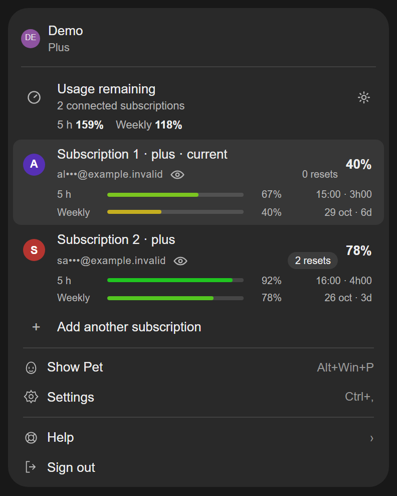
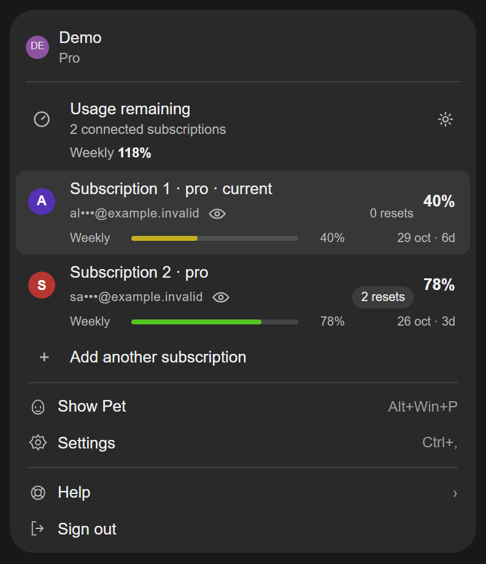
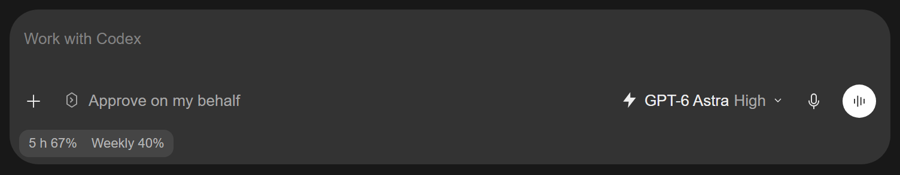
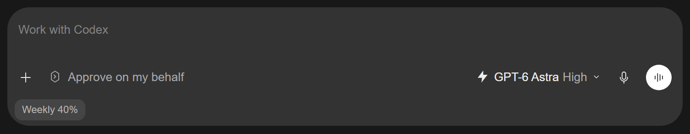
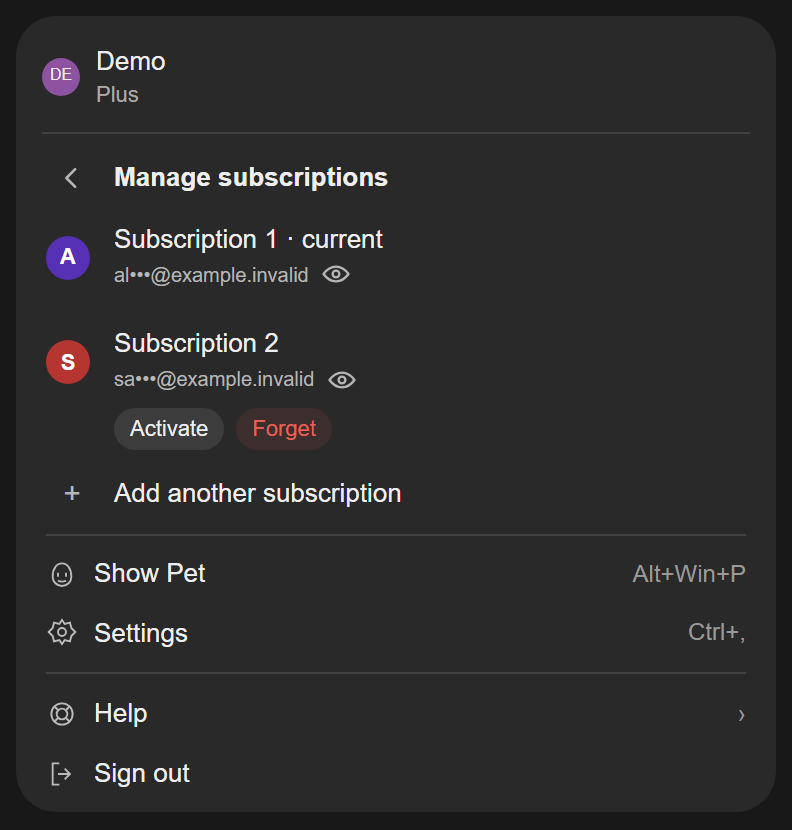

<div align="center">

# Codex Account Manager

**Live quota for all of your Codex subscriptions, inside the app's own account menu.**

Switch accounts in one click, reset quota from the panel, and land back in the
conversation you were in. Windows only.

<br>

<table>
<tr><th>5-hour + weekly quota</th><th>Weekly quota only</th></tr>
<tr>
<td></td>
<td></td>
</tr>
</table>

<sub>Every subscription in the account menu. Click one to switch. Only reported quota windows appear.</sub>

<br><br>

<strong>Visible in the chat, with the account menu closed</strong>

<br><br>



<sub>5-hour + weekly. Hover highlights the button; click opens the account panel above.</sub>

<br><br>



<sub>Weekly only. The available windows come from the account response, not a hardcoded plan rule.</sub>

<br><br>



<sub>The gear opens this: activate a saved subscription, or forget one.</sub>

</div>

These previews render the actual Manager panel and quota button with fictional
accounts. The surrounding Codex menu and composer are reconstructed preview
fixtures. Regeneration instructions are in [assets/README.md](assets/README.md).

---

## Install

```powershell
irm https://raw.githubusercontent.com/gbZyuuu/codex-account-manager/main/install.ps1 | iex
```

One line, nothing to clone. It asks for your language, installs Node.js and
Codex if they are missing, and creates a **Codex Account Manager** shortcut on
your Desktop and in the Start Menu. Open Codex through that shortcut.

## Using it

**Always visible quota.** A button on the left of the composer shows the active
account's available quota windows; absent windows are omitted, while a real 0%
remains visible. It refreshes every 30 seconds while the window is visible, with
shared requests across windows. Hover for a highlight and reset dates; click or
press Enter to open the same profile menu with every subscription.

**Quota.** Each subscription shows the quota windows reported by the service:
5-hour and weekly, or weekly only, with the percentage left, the time the window resets and how long until
then. Bars go from green to red as the quota runs out. The header adds up all
connected subscriptions.

**Switch account.** Click a subscription. The app closes and reopens signed in
as that account, back in the conversation you were in.

**Reset quota.** When a subscription has resets available, the badge shows how
many (`1 reset`, `2 resets`). Click it and the badge turns into **`Use reset?`** —
click again to confirm. Two clicks on purpose: a reset is spent for good, and a
single misclick should not burn one.

**Hide the e-mail.** The eye next to each address shows or hides it, so you can
screenshot the panel without exposing your accounts.

**Manage subscriptions.** The gear opens the second panel shown above.
**Activate** switches to that subscription. **Forget** removes the saved
credential from the list; it never offers to forget the one currently in use,
because without a saved pair there would be no way back. **Add another
subscription** saves the current session, signs out and reopens on the login
screen, so a new account can be added without going through Settings.

## Is it safe

**The original app is never modified.** Codex from the Store lives in a folder
owned by the system, which cannot be written to without administrator rights,
and this installer never asks for them. It copies the app to
`%LOCALAPPDATA%\codex-account-manager` and changes the copy. The original stays
intact and keeps receiving Store updates.

**Your chats are not touched.** They live in `~/.codex`, together with the
sign-in data. The change happens inside the copied app's `resources/app.asar`.
Different places, so the change cannot reach them. The only thing that writes
to `~/.codex` is switching accounts, which backs up the current credential
before replacing it.

**The change is small, and it is reversible.** Inside the archive there is a
`package.json` with a `main` field, and only that field changes, written in
place at the exact same length. The entry's SHA256 and block hashes in the archive
header are updated too, together with the header hash in the copied executable's
`Integrity/ElectronAsar` resource, because current Owl builds verify them at startup.
Integrity validation stays enabled. The copied executable's signature changes;
the Store executable stays untouched. Header length, file offsets and archive length
stay unchanged. The original bytes are backed up with the app
version and a hash before anything is written, and read back to validate right
after. If validation fails, it reverts in the same run. `uninstall` restores
those bytes.

## Commands

Run them as `node bin/cam.js <command>` from the folder the installer created
(`%LOCALAPPDATA%\codex-account-manager\source`).

| command | effect |
|---|---|
| `install` | copies the app if needed, patches, validates |
| `uninstall` | restores the original app and removes shortcuts and triggers |
| `doctor` | state, versions, whether the copy is out of date |
| `cleanup [--apply]` | previews obsolete app copies; `--apply` removes them |
| `check [--apply]` | detects a Codex update; `--apply` re-copies and re-patches |
| `watch install\|remove\|status` | update triggers: logon + every 6h |
| `preflight` | read-only, writes nothing |

## Codex updates

A copy is a snapshot, and snapshots age. The manager keeps one reusable copy in
`apps/current/app`: updates synchronize that directory instead of creating another
multi-GB directory per version. After a successful installation, obsolete managed
copies are removed; the active copy and any running copy are kept. Small rollback
metadata and saved accounts are retained. `cleanup` previews the same cleanup.

When a newer official version is installed on Windows, an update notice appears
below the message composer, alongside the always-visible quota. **Update and
restart** requests a normal Codex shutdown, waits for its processes to close,
updates the existing copy and reopens the current local chat when its route is
available. Finish ongoing work before clicking. If shutdown is cancelled or the
app stays open, the update is cancelled after two minutes. Checks run in a separate
process, shared across windows and cached for five minutes. This uses the version
already installed by Microsoft Store; it does not download releases from GitHub
or replace the native Store updater. Errors are saved to `log/update-last.log`.

Opening the manager shortcut checks for updates before starting a closed app.
During synchronization, a writable executable handle prevents direct launches
from racing the installer. Existing taskbar shortcuts targeting this managed
copy are redirected to the manager launcher. Launch failures include the path
to `log/launch-last.log`, which records the actual error and stack.
The shortcut waits for copying and validation to finish. When the app is already
running, it opens that instance; close all manager windows to apply an update.
The manager's own source code is updated separately by rerunning the installer.

**Slow opening.** The first launch after a Store update can take longer because
the manager synchronizes and validates the copy. An unchanged version is not
copied again. `log/launch-last.log` records the launcher's elapsed time and
whether synchronization was needed; its completion means the executable was
started, not that the Codex window is ready. `log/main.log` records loading the
original app and the renderer. Check both to distinguish manager work from
Codex initialization. Repeated clicks preserve the previous launch log entries.
The GUI launches with normal Windows visibility. Applying the helper's hidden
window flag to the app itself suppressed its first show and could require a
second activation to reveal the loaded window; this is covered by a native
Windows regression test, including launch from a hidden Node helper.

When Codex updates, the watcher rebuilds
the copy at the next logon, or within six hours. The installer turns it on for
you. If Codex is open at that moment, it waits for the next pass instead of
risking a half-written copy.

## Language

English by default. For Portuguese, set `CAM_LANG=pt`:

```powershell
$env:CAM_LANG = "pt"
node bin/cam.js doctor
```

## Requirements

Windows, Codex from the Microsoft Store, Node.js 18 or newer, and about 2.3 GB
free for the copy of the app. No npm dependencies and no build step.

## License

Free to use **and free to share**. See [LICENSE](LICENSE).

Use it, send it to people, post about it, recommend it. What you may not do is
present it as your own work, publish it under another name, or modify and
redistribute it. The line is authorship: spreading the word is encouraged,
taking credit is not.

Not affiliated with OpenAI. "Codex" and "ChatGPT" are trademarks of their
respective owners, named only to identify the program this works with.

---

<details>
<summary><b>Português</b></summary>

<br>

# Codex Account Manager

**Cota ao vivo de todas as suas assinaturas do Codex, dentro do próprio menu de
conta do aplicativo.**

Troca de conta em um clique, redefinição de cota pelo painel, e volta na
conversa onde você estava. Somente Windows.

## Instalação

```powershell
irm https://raw.githubusercontent.com/gbZyuuu/codex-account-manager/main/install.ps1 | iex
```

Uma linha, sem clonar nada. Ele pergunta seu idioma, instala o Node.js e o Codex
se estiverem faltando, e cria um atalho **Codex Account Manager** na Área de
Trabalho e no Menu Iniciar. Abra o Codex por esse atalho.

## Como usar

**Cota sempre visível.** Um botão à esquerda do campo de mensagem mostra os limites
disponíveis da conta ativa; limites ausentes são ocultados e uma cota real de 0%
continua visível. Atualiza a cada 30 segundos enquanto a janela está visível,
compartilhando consultas entre janelas. Passe o mouse para destacar o botão e ver
os horários de renovação; clique ou pressione Enter para abrir o mesmo menu do
perfil com todas as assinaturas.

**Cota.** Cada assinatura mostra duas barras: a janela de 5 horas e a semanal,
com a porcentagem restante, o horário em que a janela reinicia e quanto falta.
As barras vão de verde a vermelho conforme a cota acaba. O cabeçalho soma todas
as assinaturas conectadas.

**Trocar de conta.** Clique numa assinatura. O aplicativo fecha e reabre logado
naquela conta, de volta na conversa onde você estava.

**Redefinir cota.** Quando a assinatura tem redefinições disponíveis, o selo
mostra quantas (`1 reset`, `2 resets`). Clique nele e o selo vira
**`Use reset?`** — clique de novo para confirmar. Dois cliques de propósito: uma
redefinição é gasta para sempre, e um clique errado não deve queimar uma.

**Esconder o e-mail.** O olhinho ao lado de cada endereço mostra ou esconde,
para você poder tirar print do painel sem expor suas contas.

**Gerenciar assinaturas.** A engrenagem abre o segundo painel mostrado no topo.
**Activate** troca para aquela assinatura e **Forget** remove a credencial salva da
lista. Ele nunca oferece esquecer a que está em uso, porque sem um par salvo não
haveria como voltar. **Add another subscription** salva a sessão atual, sai da conta
e reabre na tela de login, para adicionar uma conta nova sem passar pelas
Configurações.

## É seguro

**O aplicativo original nunca é modificado.** O Codex da Loja fica numa pasta
que pertence ao sistema, onde não se escreve sem direitos de administrador, e
este instalador nunca os pede. Ele copia o aplicativo para
`%LOCALAPPDATA%\codex-account-manager` e altera a cópia. O original continua
intacto e continua recebendo atualizações da Loja.

**Seus chats não são tocados.** Eles ficam em `~/.codex`, junto com os dados de
login. A alteração acontece dentro do `resources/app.asar` da cópia. São lugares
diferentes, então a alteração não os alcança. A única coisa que escreve em
`~/.codex` é a troca de conta, que faz backup da credencial atual antes de
substituir.

**A alteração é pequena, e é reversível.** Dentro do arquivo existe um
`package.json` com o campo `main`, alterado no lugar com
exatamente o mesmo tamanho. Os hashes SHA256 do arquivo, dos blocos e do cabeçalho
também são atualizados; o hash do cabeçalho fica no recurso `Integrity/ElectronAsar`
do executável copiado. A validação continua habilitada. A assinatura da cópia
personalizada muda, e o executável da Loja permanece intacto. Os bytes originais são guardados com a versão do
aplicativo e um hash antes de qualquer escrita, e lidos de volta para validar
logo depois. Se a validação falhar, ele reverte na mesma execução. O `uninstall`
restaura esses bytes.

## Comandos

Rode como `node bin/cam.js <comando>` na pasta que o instalador criou
(`%LOCALAPPDATA%\codex-account-manager\source`).

| comando | efeito |
|---|---|
| `install` | copia o aplicativo se preciso, altera, valida |
| `uninstall` | restaura o original e remove atalhos e gatilhos |
| `doctor` | estado, versões, se a cópia está desatualizada |
| `cleanup [--apply]` | lista cópias antigas; `--apply` remove as inativas |
| `check [--apply]` | detecta atualização do Codex; `--apply` recopia e reaplica |
| `watch install\|remove\|status` | gatilhos de atualização: logon + a cada 6h |
| `preflight` | somente leitura, não escreve nada |

## Atualizações do Codex

Uma cópia é um retrato, e retrato envelhece. O gerenciador mantém uma única cópia
reutilizável em `apps/current/app`, sincronizada entre versões. Depois de uma
instalação validada, cópias antigas inativas são removidas. A cópia ativa, cópias em
execução, metadados de rollback e contas salvas são preservados. `cleanup` permite
ver essa limpeza antes de aplicá-la.

Quando uma versão oficial mais recente estiver instalada no Windows, aparece um
aviso abaixo do campo de mensagem, junto da cota sempre visível. **Atualizar e
reiniciar** solicita o fechamento normal do Codex, aguarda seus processos saírem,
atualiza a cópia existente e reabre o chat local atual quando a rota estiver
disponível. Conclua as tarefas em andamento antes de clicar. Se o fechamento for
cancelado ou o aplicativo continuar aberto, a atualização é cancelada após dois
minutos. A consulta roda em processo separado, compartilhada entre janelas e com
cache de cinco minutos. Ela usa a versão já instalada pela Microsoft Store; não
baixa versões do GitHub nem substitui o atualizador da Loja. Erros ficam em
`log/update-last.log`.

O atalho do gerenciador verifica atualizações antes de abrir o aplicativo fechado
e protege o executável contra abertura direta durante a sincronização. Atalhos
existentes na barra de tarefas que apontam para esta cópia passam pelo lançador
do gerenciador. Falhas de abertura indicam `log/launch-last.log`, que registra o
erro detalhado.

O lançador verifica a atualização
e aguarda a cópia e a validação terminarem. Se ele já estiver aberto, abre a
instância existente; feche todas as janelas do gerenciador para aplicar uma
atualização. O código do próprio gerenciador é atualizado separadamente,
executando novamente o instalador.

**Abertura lenta.** A primeira abertura após uma atualização da Loja pode demorar
mais pela sincronização e validação. A mesma versão não é copiada novamente.
`log/launch-last.log` registra o tempo do lançador e se houve sincronização;
o término indica que o executável iniciou, não que a janela está pronta.
`log/main.log` registra o carregamento do aplicativo original e da interface.
Os dois registros permitem separar o tempo do gerenciador da inicialização do
Codex. Cliques repetidos preservam as entradas anteriores do log de abertura.
O aplicativo abre com visibilidade normal no Windows. A opção usada para ocultar
os auxiliares também estava sendo aplicada à janela do Codex, suprimindo sua
primeira exibição e podendo exigir uma segunda ativação. A correção tem um teste
nativo do Windows que também cobre a abertura por um auxiliar Node oculto.

Quando o Codex atualiza, o vigia
refaz a cópia no próximo logon, ou dentro de seis horas. O instalador liga isso
para você. Se o Codex estiver aberto na hora, ele espera a próxima passada em vez
de arriscar deixar a cópia pela metade.

## Idioma

Inglês por padrão. Para português, defina `CAM_LANG=pt`.

## Requisitos

Windows, Codex da Microsoft Store, Node.js 18 ou mais novo, e cerca de 2,3 GB
livres para a cópia do aplicativo. Sem dependências de npm e sem passo de build.

## Licença

Livre para usar **e livre para compartilhar**. Veja [LICENSE](LICENSE).

Use, envie para as pessoas, poste, recomende. O que não pode é apresentar como
trabalho seu, publicar sob outro nome, ou modificar e redistribuir. A linha é a
autoria: divulgar é incentivado, tomar o crédito não é.

Não é afiliado à OpenAI. "Codex" e "ChatGPT" são marcas de seus respectivos
titulares, citadas apenas para identificar o programa com o qual isto funciona.

</details>
